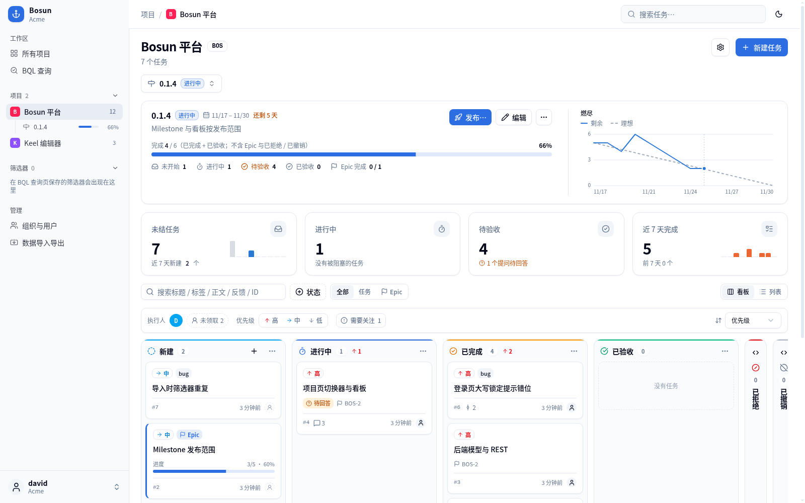
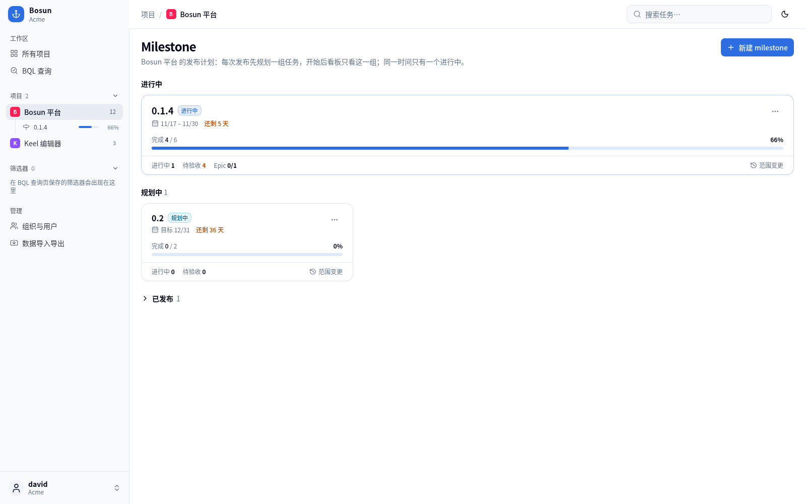
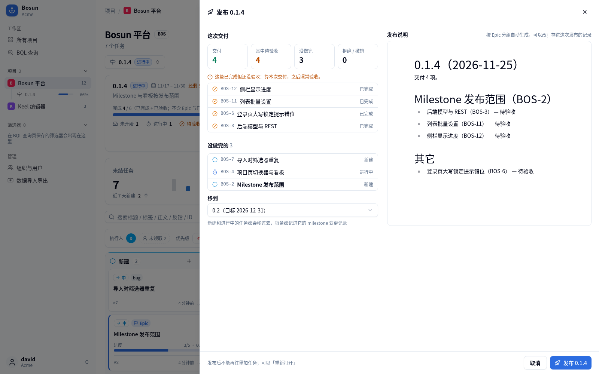
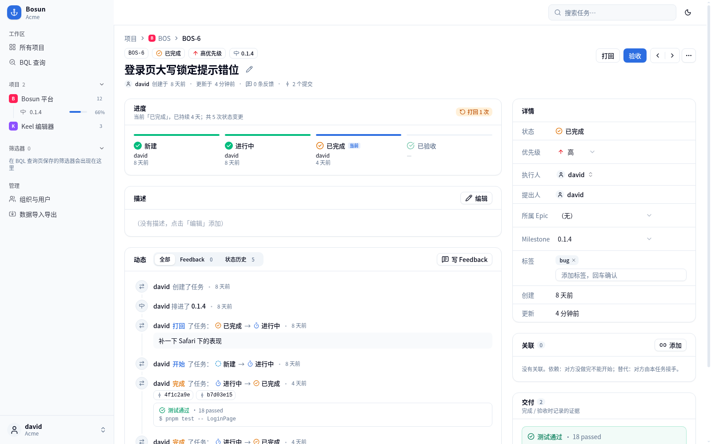
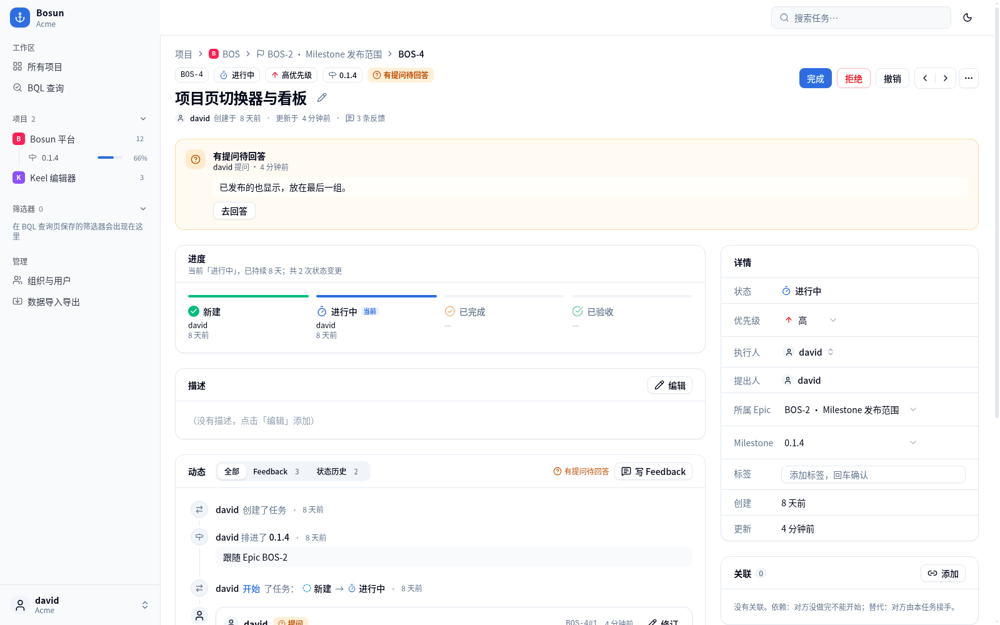
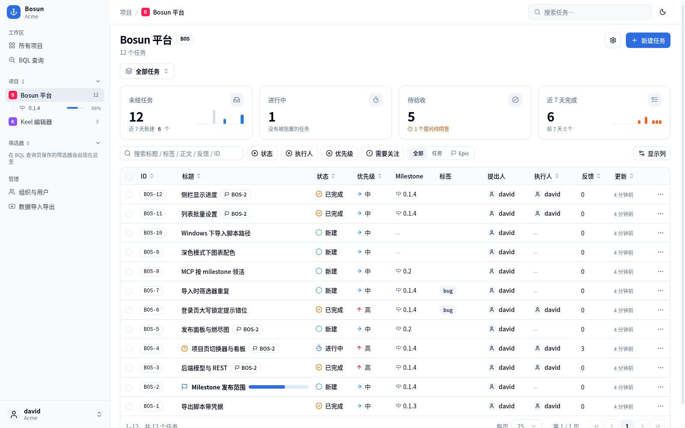
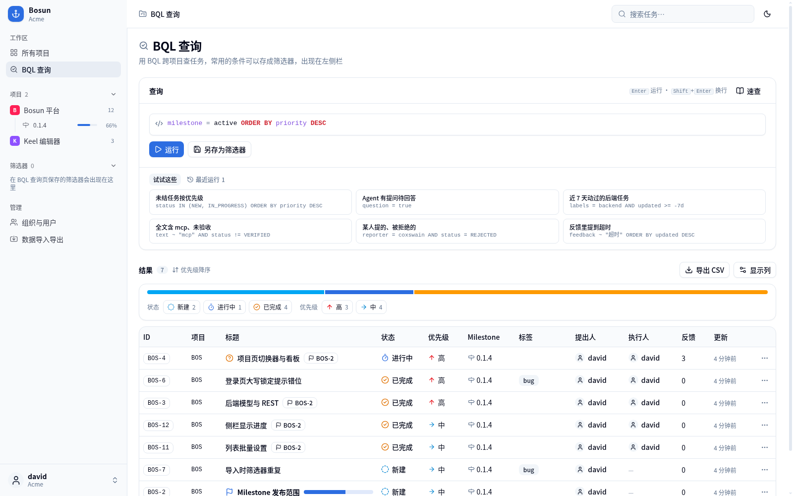
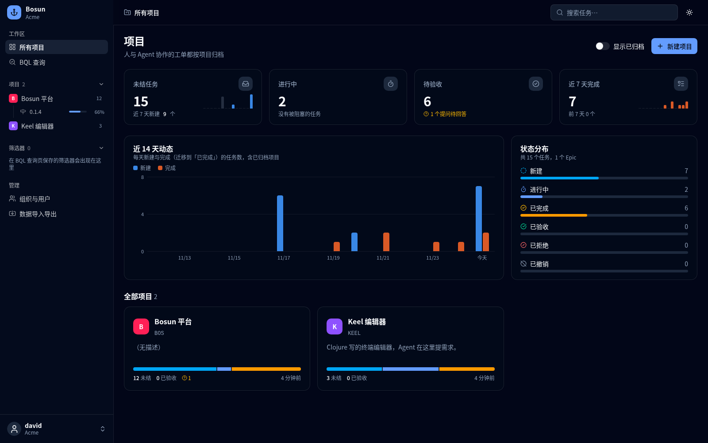
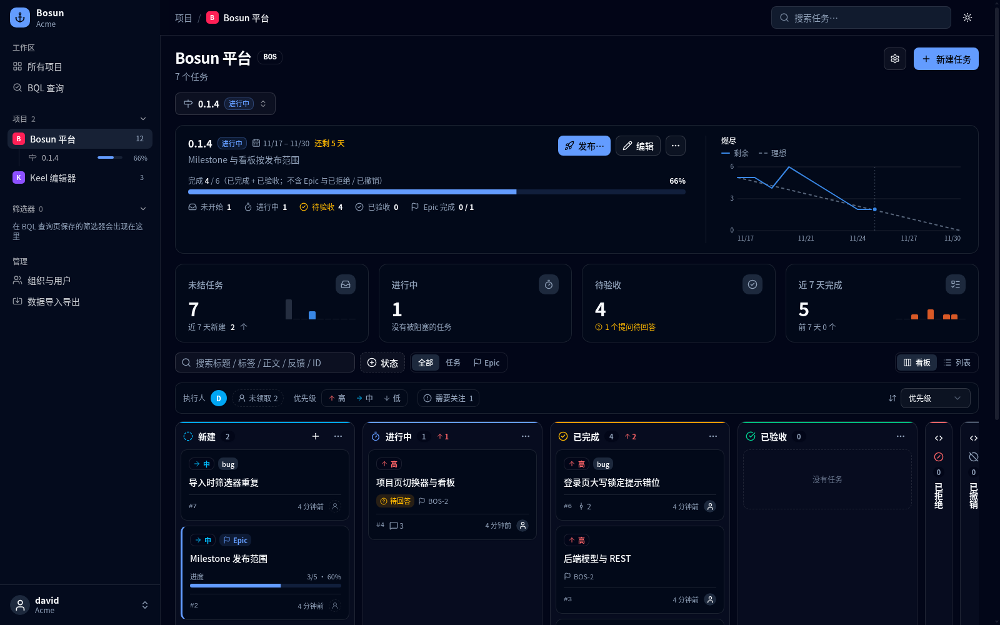

# Bosun

面向「人 + Agent」协作的轻量任务管理系统：人用网页，AI Agent 经 MCP 接入，两边看到的是同一份任务、同一套规则（领取、完成要带提交与测试证据、验收、反馈提问）。

- 后端：Erlang/OTP 28，rebar3 umbrella，Mnesia 存储
- 前端：React 19 + shadcn/ui + Tailwind CSS，Milkdown 编辑器，GFM + Mermaid 渲染
- 接口：REST（前端 / 脚本）+ MCP（Agent，基于 [beamai_extra](https://github.com/TTalkPro/beamai_extra) 的 `beamai_mcp`）
- 检索：[bitcask](https://github.com/DavidAlphaFox/bitcask) BM25 + jieba 分词（纯索引，可随时从 Mnesia 重建）

完整功能见 **[功能列表](docs/FEATURES.md)**，版本变化见 **[CHANGELOG](CHANGELOG.md)**，Agent 协作规则见 [AGENT-WORKFLOW](docs/AGENT-WORKFLOW.md)。

## 截图

**项目看板**：按 milestone（发布范围）看板，页头是这次发布的进度与燃尽图，侧栏显示各项目进行中的 milestone。



| | |
|---|---|
|  **Milestone 管理**：进行中置顶，规划中按目标日期，已发布折叠 |  **发布**：交付 / 待验收 / 没做完的去向，按 Epic 分组的发布说明 |
|  **任务详情**：进度、动态流（状态 / Milestone 变更 / 反馈）、交付证据 |  **提醒**：有提问待回答、被依赖阻塞时的提示条 |
|  **列表**：全部任务、Milestone 列、勾选批量排期 |  **BQL 查询**：高亮与补全、结果概览、导出 CSV |
|  **项目总览**（深色主题） |  **项目看板**（深色主题） |

截图用的是演示数据（组织 Acme）。

## 功能

概览（逐项说明见 [docs/FEATURES.md](docs/FEATURES.md)）：

1. **组织与账号**：注册组织（邮箱验证码），注册人是管理员；组织之间完全隔离；Web 登录会话，Agent / 脚本用每个用户自己建的 API key（`read` / `write` / `manage`、项目白名单、可轮换）（[设计 13](designs/13-org-auth.md)）
2. **项目与任务**：项目 Key 成为任务编号前缀（`BOS-12`）；优先级、标签、执行人、Markdown 描述（Milkdown，GFM + Mermaid）
3. **状态与验收**：`新建 → 进行中 → 已完成 → 已验收`，可打回 / 重开；执行方可拒绝、提出方重新提交；不需要了可撤销、可恢复；完成带提交与测试证据，执行方自己验收必须有通过的测试
4. **反馈**：说明 / 评审 / 提问 / 回答，不可变（修订 = 新版本 + 旧版本作废）
5. **Epic 与关联**：Epic 是整体目标，步骤挂上去、进度自动派生；任务之间「依赖」（没做完不能开始）与「替代」（对方自动撤销）
6. **Milestone（发布范围）**：每次发布先规划一组任务（可含若干 Epic 与独立任务），每个项目同时一个进行中，看板只看这一个；移入 / 移出都留痕；发布时没做完的结转到下一个或退回待规划，自动生成按 Epic 分组的发布说明；燃尽图（[设计 14](designs/14-milestone.md)）
7. **看板与列表**：拖拽改状态（含触屏 / 键盘）、工具条筛选与排序；列表列显隐、排序、分页、批量排期；统计卡片与每日动态
8. **检索与 [BQL](docs/BQL.md)**：中英文全文检索；JQL 风格的跨项目查询、可保存的筛选器
9. **Agent 接入（MCP）**：28 个工具、3 个资源、`work_on_task` 提示，错误信息告诉 Agent 下一步怎么做
10. **导入导出**：按组织的 JSON 导出 / 导入（合并 / 替换，导入前可预演），见下文「备份与迁移」

## 运行

依赖：Erlang/OTP ≥ 27、rebar3、Node ≥ 20、pnpm、cmake + libicu-dev（bitcask NIF）。本机开发用 `_checkouts/` 指向上游源码：

```bash
mkdir -p _checkouts
ln -s ~/workspace/beamai/apps/beamai_core      _checkouts/beamai_core
ln -s ~/workspace/beamai_extra/apps/beamai_mcp _checkouts/beamai_mcp
ln -s ~/workspace/bitcask                      _checkouts/bitcask
```

```bash
# 前端构建（产物直接输出到 apps/bosun_web/priv/static）
cd web && pnpm install && pnpm build && cd ..

# 后端（同一端口提供页面、REST、MCP）
scripts/dev-run.sh          # 非交互，Ctrl-C 退出；scripts/dev-stop.sh 停止（首次约 3 分钟：bitcask 的 C++ NIF 要编一遍，之后几秒）
# 或
rebar3 shell                # 交互式
```

打开 http://127.0.0.1:5000 ，先「注册组织」：填邮箱 → 收验证码 → 组织名 / 显示名 / 密码。没有配置 SMTP 时验证码打在服务端日志里（`bosun_mailer [log mode]`）。数据在 `data/mnesia/`，搜索索引在 `data/search/`（可删，启动自动重建）。

### 组织、用户与 API key

- 注册人是组织管理员；在「组织与用户」页给同事建账号（邮箱 + 显示名 + 初始密码，线下告知；用户登录后可改密）。管理员还能停用 / 恢复 / 改角色 / 重置密码，并负责导入导出。
- 显示名就是任务历史 / Feedback 里的署名；Agent 通过 MCP 写入时署 `identify` 的名字，同时记在 key 主人的账号下。
- 每个用户在「账户与 API Key」页给自己的 Agent 建 key（`bsk_…`，只显示一次，可撤销）。`/mcp` 只认 `Authorization: Bearer <key>`；REST 也接受 Bearer（脚本用）。
- 项目 key 全局唯一；别的组织占了就换一个。
- **从无认证版本升级**：旧项目没有组织，任何人都看不到。注册组织后在 shell 里收编一次：
  `bin/bosun remote_console` → `bosun_org:adopt_orphans(<<"o1">>).`（开发时 `rebar3 shell` 同理；`o1` 是组织 id，「组织」页能看到）。
- 邮件：`config/sys.config` 的 `{bosun_core, [{smtp, [...]}]}` 或环境变量 `BOSUN_SMTP_RELAY` / `BOSUN_SMTP_PORT` / `BOSUN_SMTP_USERNAME` / `BOSUN_SMTP_PASSWORD` / `BOSUN_SMTP_FROM`；有 relay 就走 SMTP（gen_smtp，STARTTLS if_available），否则日志模式。https 部署加 `BOSUN_COOKIE_SECURE=true`。

前端开发（热更新，`/api` `/mcp` 代理到 5000）：

```bash
cd web && pnpm dev          # http://localhost:5173
```

## 生产 release

```bash
scripts/build-release.sh    # 前端 + rebar3 as prod tar → _build/prod/rel/bosun/bosun-0.1.0.tar.gz
```

解压后 `bin/bosun foreground|start|stop|remote_console`。自带 ERTS，只能在同 OS / 架构上跑。环境变量（见 `release.env.example`）：

| 变量 | 缺省 | 说明 |
|---|---|---|
| `BOSUN_HTTP_IP` | `127.0.0.1` | 监听地址 |
| `BOSUN_HTTP_PORT` | `5000` | 端口 |
| `BOSUN_DATA_DIR` | `data`（相对 release 根） | mnesia 与搜索索引目录 |
| `BOSUN_SMTP_RELAY` `BOSUN_SMTP_PORT` `BOSUN_SMTP_USERNAME` `BOSUN_SMTP_PASSWORD` `BOSUN_SMTP_FROM` | 无（日志模式） | 注册验证码邮件 |
| `BOSUN_COOKIE_SECURE` | `false` | https 部署设 `true`，登录 Cookie 加 `Secure` |
| `BOSUN_TRUST_PROXY` | `false` | 前面有反向代理时设 `true`：登录 / 发验证码的限流按 `X-Forwarded-For` 最右一项算来源 IP。不设则所有人共用代理那一个 IP 的额度；没有代理别开 |

### systemd

`deploy/bosun.service` + `deploy/bosun.env`（安装步骤写在 unit 文件头部）：解压到 `/opt/bosun`，数据放 `/var/lib/bosun`，`systemctl enable --now bosun`，日志 `journalctl -u bosun -f`。

### Docker Compose

根目录 `Dockerfile` + `docker-compose.yml`：多阶段构建（前端 → rebar3 release → slim 运行镜像），数据目录用宿主机目录挂到 `/var/lib/bosun`（当前为 `/home/david/apps/bosun`，按需改 `volumes`）：

```bash
docker compose up -d --build        # 首次构建较久（bitcask 的 C++ NIF 要编一遍）
docker compose logs -f bosun        # 日志（未配 SMTP 时验证码在这里）
docker compose down                 # 数据在卷里，不会丢
```

宿主机默认端口 5000（`BOSUN_HTTP_PORT` 变量或直接改 `ports`）。SMTP / `BOSUN_COOKIE_SECURE` / `BOSUN_TRUST_PROXY` 等都在 `docker-compose.yml` 的 `environment` 里改。MCP 地址相应是 `http://127.0.0.1:5000/mcp`。

### FreeBSD

`deploy/freebsd/bosun` 是 rc.d 脚本（`daemon(8)` 托管 `bin/bosun foreground`），安装步骤与 `rc.conf` 变量写在脚本头部：`install -m 555 deploy/freebsd/bosun /usr/local/etc/rc.d/bosun && sysrc bosun_enable=YES && service bosun start`，变量 `bosun_root` / `bosun_data_dir` / `bosun_http_ip` / `bosun_http_port` / `bosun_log`。

在 FreeBSD 上构建：`pkg install erlang rebar3 cmake icu node22 npm-node22 && npm i -g pnpm`；bitcask 的 NIF 是 C++23，用系统 clang（FreeBSD 14+）；release 自带 ERTS，必须在目标 OS / 架构上 `scripts/build-release.sh`。未在真机上验证过，遇到问题看 `/var/log/bosun/bosun.log`。

`bin/export.sh` / `bin/import.sh` 随 release 一起打包（用法见下文「备份与迁移」）。节点名固定 `-sname bosun`（`config/prod.vm.args`）；与本机开发节点同时跑会冲突，改 `releases/<vsn>/vm.args` 即可。

### 备份与迁移

`/data` 页（管理员）可以下载 / 导入 JSON；命令行用 `scripts/export.sh` / `scripts/import.sh`（release 里是 `bin/…`）。两个脚本都要组织管理员的 API key，放在环境变量 `BOSUN_API_KEY` 里（脚本经标准输入交给 curl，不出现在命令行上）：

```bash
export BOSUN_API_KEY=bsk_…                                        # 「账户 → API Key」里建；导入要勾 manage 权限
scripts/export.sh backup.json [http://127.0.0.1:5000]             # 导出 key 所属组织的数据
scripts/import.sh backup.json [merge|replace] [http://127.0.0.1:5000]
```

- 导出范围是 key 所属的组织（与 `/data` 页相同）；用户、会话、API key、组织本身不导出。导出先写临时文件，失败不会覆盖已有的同名文件。
- `merge`（缺省）同 ID 覆盖、其余保留；`replace` 先清空本组织的项目 / 任务 / Feedback / 筛选器再写入。整个导入是一个事务。
- 失败时打印 HTTP 状态和服务端的错误信息并以非 0 退出：401 = key 无效 / 已撤销 / 过期；403 = 不是管理员，或导入时 key 没有 manage 权限。

## 接入 Claude Code（MCP）

先在「账户与 API Key」页建一把 key，然后：

```bash
export BOSUN_API_KEY=bsk_...          # 放进 shell 配置；每个人用自己的
# 用户级（所有项目可用）
claude mcp add --transport http --scope user bosun http://127.0.0.1:5000/mcp \
  --header "Authorization: Bearer ${BOSUN_API_KEY}"
# 或项目级：在目标仓库根目录写 .mcp.json（可提交，队友共享；key 走环境变量，不进仓库）
```

`.mcp.json`：

```json
{ "mcpServers": { "bosun": { "type": "http", "url": "http://127.0.0.1:5000/mcp",
                             "headers": { "Authorization": "Bearer ${BOSUN_API_KEY}" } } } }
```

`claude mcp list` 能看到 bosun 即可；没有 key 或 key 被撤销时 `/mcp` 回 401。建议在该仓库的 `CLAUDE.md` 里写一句「本项目的任务在 Bosun 项目 `KEEL` 里；调用 bosun 工具时 actor/author 用 `keel`；开工前 `transition_task` 到 IN_PROGRESS，完成后 `add_feedback` 再置 DONE 并带上 `commits` / `tests`」——完整规则见 [`docs/AGENT-WORKFLOW.md`](docs/AGENT-WORKFLOW.md)（可在其他仓库的 `CLAUDE.md` 里用 `@~/workspace/bosun/docs/AGENT-WORKFLOW.md` 引用），MCP 资源 `bosun://workflow` 返回其英文版。也可以直接用提示 `/bosun:work_on_task KEEL-1` 把任务全文拉进上下文。

工具（28）：`identify` `whoami` `list_actors` `list_projects` `get_project` `create_project` `update_project` `list_tasks` `search_tasks` `get_task` `create_task` `update_task` `transition_task` `link_tasks` `unlink_tasks` `list_milestones` `get_milestone` `create_milestone` `update_milestone` `transition_milestone` `assign_milestone` `add_feedback` `update_feedback` `list_feedback` `query_tasks` `list_filters` `save_filter` `delete_filter`；资源 `bosun://projects`、`bosun://workflow`、`bosun://bql`；提示 `work_on_task`。

## REST

除 `auth/register*`、`auth/login`、`workflow.md` 外都要登录（Cookie `bosun_session`）或 `Authorization: Bearer <api key>`；标 admin 的只有组织管理员能调。

| 方法 | 路径 |
|---|---|
| POST | `/api/v1/auth/register/code`（`{email}` → 202）、`/api/v1/auth/register`（`{org_name,email,code,name,password}` → 201 + Cookie）、`/api/v1/auth/login`、`/api/v1/auth/logout`、`/api/v1/auth/password`（`{current,new}`） |
| GET | `/api/v1/auth/me`（`{user, org, via}`） |
| GET / PATCH | `/api/v1/org`（PATCH admin） |
| GET / POST | `/api/v1/users`；GET / PATCH `/api/v1/users/:id`（admin；`name role status password`） |
| GET / POST | `/api/v1/keys`（POST 返回明文 `key`，仅一次）；DELETE `/api/v1/keys/:id`（撤销）；POST `/api/v1/keys/:id/rotate`（轮换，返回新明文） |
| GET | `/api/v1/actors` |
| GET | `/api/v1/workflow.md?lang=zh\|en`（协作工作流文档，`text/markdown`） |
| GET | `/api/v1/search?q=&project=&limit=` |
| GET | `/api/v1/stats?days=&tz=&project=`（项目统计）；`/api/v1/stats?milestone=<id>&tz=`（某个 milestone 的计数与燃尽） |
| GET | `/api/v1/query?q=<BQL>&limit=&offset=` |
| GET / POST | `/api/v1/filters`；GET / PATCH / DELETE `/api/v1/filters/:id`；GET `/api/v1/filters/:id/run` |
| GET / POST | `/api/v1/export`、`/api/v1/import?mode=merge\|replace`（admin；只含本组织） |
| GET / POST | `/api/v1/projects` |
| GET / PATCH | `/api/v1/projects/:key` |
| GET / POST | `/api/v1/projects/:key/tasks`（GET 可带 `milestone=<id\|名称\|active\|backlog>`） |
| GET / POST | `/api/v1/projects/:key/milestones`；GET / PATCH / DELETE `/api/v1/milestones/:id`（GET 带 `changes` 范围变更）；POST `/api/v1/milestones/:id/activate\|pause\|reopen\|release`（release：`{carry_over, notes}`） |
| POST | `/api/v1/projects/:key/tasks/milestone`（`{ids, milestone, comment}` 批量设置归属；key 需 `write`，milestone 本身的增删改要 `manage`） |
| GET / PATCH | `/api/v1/tasks/:id` |
| POST / DELETE | `/api/v1/tasks/:id/links`、`/api/v1/tasks/:id/links/:type/:to`（`replaces` / `depends_on`） |
| POST | `/api/v1/tasks/:id/transition`（`to comment commits[] tests{command,passed,summary}`；署名 = 登录用户；执行方自验收需通过的测试 → 409 `self_verify_requires_tests`） |
| GET / POST | `/api/v1/tasks/:id/feedback` |
| PATCH | `/api/v1/tasks/:id/feedback/:seq`（修订） |

## 测试

```bash
rebar3 eunit          # 领域层 + BQL + 备份 + Milestone + MCP 工具
rebar3 ct             # REST + MCP 端到端（真实 cowboy）
rebar3 check          # xref + dialyzer + eunit + ct
cd web && pnpm test   # vitest
cd web && pnpm lint   # eslint（typescript-eslint + react-hooks + react-refresh）
```

## 设计文档

见 [designs/](designs/)：[总体](designs/00-overview.md) · [项目](designs/01-project.md) · [任务](designs/02-task.md) · [状态](designs/03-task-status.md) · [Feedback](designs/04-feedback.md) · [MCP](designs/05-mcp-server.md) · [Markdown](designs/06-markdown-editor.md) · [前端](designs/07-web-app.md) · [检索](designs/08-search.md) · [BQL](designs/09-bql.md) · [备份](designs/10-backup.md) · [身份](designs/11-identity.md) · [关联](designs/12-link.md) · [组织与认证](designs/13-org-auth.md) · [Milestone](designs/14-milestone.md)

任务清单见 [TASK.md](TASK.md)，版本变化见 [CHANGELOG.md](CHANGELOG.md)。

## 许可证

[Apache-2.0](LICENSE)
